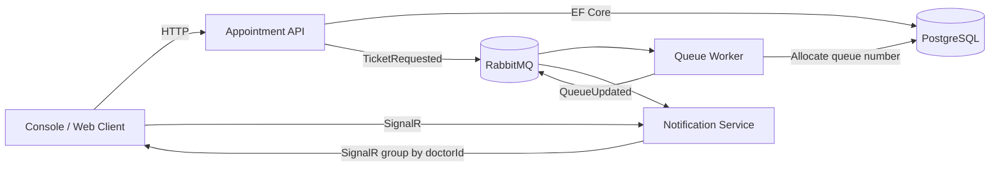
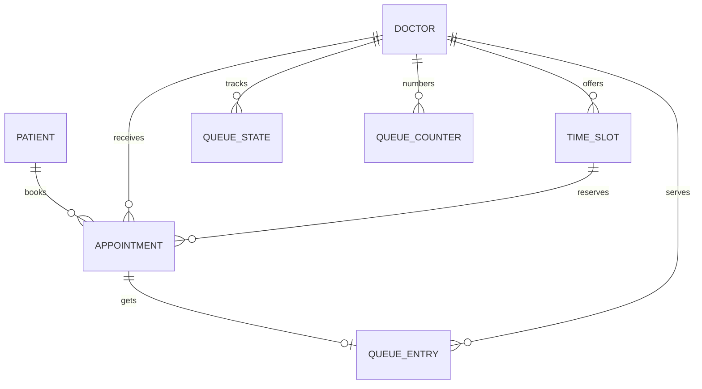

# Clinic Appointment and Queue

Solution skeleton cho Đề tài 09, dùng .NET 10, PostgreSQL, RabbitMQ và SignalR. Phạm vi hiện tại là kiến trúc, mô hình dữ liệu và môi trường container. Nghiệp vụ đặt lịch, consumer RabbitMQ, migrations, seed data và client tương tác đầy đủ thuộc phần triển khai tiếp theo.

## Kiến trúc



`Clinic.Domain` sở hữu entity và trạng thái; `Clinic.Contracts` định nghĩa message dùng chung; `Clinic.Infrastructure` chứa DbContext/configuration; các executable service được build và scale độc lập. Trong phiên bản tiếp theo, API sẽ ghi lịch hẹn và outbox trong cùng transaction; Worker cấp số và Notification Service phát thay đổi hàng đợi. RabbitMQ là transport bất đồng bộ, còn PostgreSQL là nguồn dữ liệu chuẩn.

## Cây thư mục

```text
ClinicQueue.slnx
src/
  Clinic.Contracts/          # TicketRequested, QueueUpdated
  Clinic.Domain/              # Patient, Doctor, TimeSlot, Appointment, Queue*
  Clinic.Infrastructure/      # EF Core DbContext, provider registration
  Clinic.AppointmentApi/      # ASP.NET Core Minimal API host
  Clinic.QueueWorker/         # Worker Service host
  Clinic.NotificationService/ # SignalR hub host
  Clinic.ConsoleClient/       # Console health-check client sample
```

## Mô hình dữ liệu



`QueueState` và `QueueCounter` có khóa ghép `(DoctorId, ServiceDate)`. Unique index trên `(DoctorId, ServiceDate, QueueNumber)` và `(DoctorId, ServiceDate, Number)` là lớp bảo vệ cuối cho số thứ tự; unique index slot `(DoctorId, StartTime)` tránh tạo trùng khung giờ. `TimeSlot` có check constraint `0 <= BookedCount <= Capacity`. Khi triển khai booking, tăng `BookedCount` cần dùng conditional atomic update trong transaction để chặn overbooking.

## Chạy bằng Docker Compose

Cần Docker Desktop/Docker Compose v2. Tại thư mục solution:

```powershell
Copy-Item .env.example .env
# Sửa POSTGRES_PASSWORD và RABBITMQ_PASSWORD trong .env
docker compose up --build -d
docker compose ps
```

API: `http://localhost:8080/health/live`; readiness: `http://localhost:8080/health/ready`; Notification Service: `http://localhost:8081/health/live`; SignalR hub: `http://localhost:8081/hubs/queue`. RabbitMQ management UI: `http://localhost:15672`.

Chạy client mẫu một lần: `docker compose --profile demo-client run --rm console-client`. Theo dõi log: `docker compose logs -f appointment-api queue-worker notification-service`. Dừng services: `docker compose down`; xoá database/broker data chỉ khi cần reset hoàn toàn: `docker compose down -v`.

## Cấu hình và logging

Compose inject cấu hình bằng biến môi trường theo quy tắc ASP.NET Core: `ConnectionStrings__Clinic`, `RabbitMq__HostName`, `RabbitMq__UserName`, `RabbitMq__Password`, `Logging__LogLevel__Default`. Trong container, dùng service name `postgres` và `rabbitmq`, không dùng `localhost`. `.env` chỉ dành cho local development; môi trường thật nên lấy secrets từ secret store/orchestrator.

Các host phát console JSON logs, phù hợp để Docker thu thập và lọc. Giữ log mức `Information` cho luồng nghiệp vụ, `Warning` cho retry/dependency chậm và thêm correlation/appointment ID khi triển khai consumer để lần theo một request xuyên API → broker → Worker → notification. Không ghi số điện thoại hoặc dữ liệu định danh bệnh nhân vào log.

## Build local

```powershell
dotnet build ClinicQueue.slnx
dotnet run --project src/Clinic.AppointmentApi
```

Các project hiện build được; database phải chạy và `ConnectionStrings__Clinic` phải được cấu hình khi khởi chạy API. Health endpoint, hub và Queue Worker hiện là skeleton, không đại diện nghiệp vụ booking hay RabbitMQ consumer đã hoàn tất.

Đây là ranh giới chủ đích của Phần 1, không phải bản phát hành production-ready.
