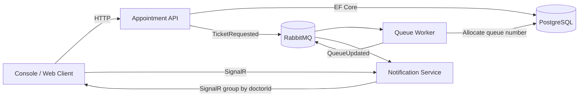
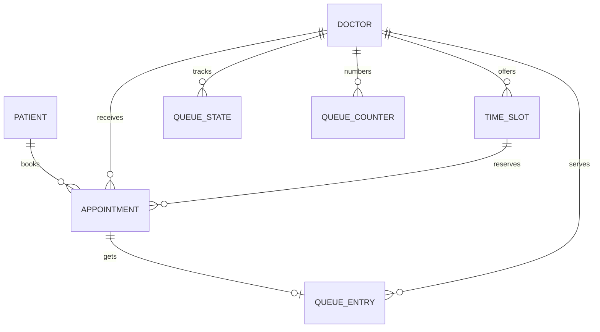

# Clinic Appointment and Queue

Hệ thống đặt lịch khám và quản lý hàng đợi dùng .NET 10 Minimal API, EF Core/PostgreSQL, RabbitMQ và SignalR. Appointment API ghi lịch hẹn cùng transactional outbox; Queue Worker consume `ticket.requested`, cấp số thứ tự và ghi queue update event.

## Kiến trúc



`Clinic.Domain` sở hữu entity và trạng thái; `Clinic.Contracts` định nghĩa message dùng chung; `Clinic.Infrastructure` chứa DbContext, PostgreSQL retry strategy, RabbitMQ publisher và outbox dispatcher. API ghi lịch hẹn cùng `ticket.requested` vào PostgreSQL trong một transaction. Dispatcher publish message persistent với publisher confirm; nếu broker gián đoạn, outbox giữ message và retry theo exponential backoff. Worker consume manual-ack; DB commit xong mới ack. Delivery là at-least-once, Worker khóa appointment khi xử lý và bỏ qua message trùng theo trạng thái/`QueueNumber`.

## Cây thư mục

```text
ClinicQueue.slnx
src/
  Clinic.Contracts/          # TicketRequested, QueueUpdated
  Clinic.Domain/              # Patient, Doctor, TimeSlot, Appointment, Queue*
  Clinic.Infrastructure/      # EF Core DbContext, provider registration
  Clinic.AppointmentApi/      # ASP.NET Core Minimal API host
  Clinic.QueueWorker/         # Worker Service host
  Clinic.NotificationService/ # SignalR hub host
  Clinic.ConsoleClient/       # Console API and SignalR client
```

## Mô hình dữ liệu



`QueueState` và `QueueCounter` có khóa ghép `(DoctorId, ServiceDate)`. Worker dùng PostgreSQL atomic upsert trên `QueueCounter` để lấy số kế tiếp, được bảo vệ thêm bởi unique index `(DoctorId, ServiceDate, QueueNumber)` và `(DoctorId, ServiceDate, Number)`. `TimeSlot` có check constraint cho capacity; booking dùng conditional atomic update trong transaction để chặn overbooking.

Worker khai báo durable queue `clinic.ticket-requests`, retry queues có TTL tăng dần tới 60 giây và dead-letter queue `clinic.ticket-dead-letters`. Lỗi DB được retry qua retry exchange; payload sai hoặc trạng thái không hợp lệ được chuyển vào DLQ để kiểm tra thủ công. Sự kiện `queue.updated` được ghi vào outbox trong cùng transaction cấp số; dispatcher có thể chạy ở API hoặc Worker và dùng lease để tránh cùng claim một message. Notification Service consume durable queue `clinic.queue-updates`, broadcast tên event `QueueUpdated` vào group `doctor:{id}` rồi ack; lỗi gửi được retry và poison message vào `clinic.queue-update-dead-letters`.

## Appointment API

| Method | Path | Mục đích |
| --- | --- | --- |
| `GET` | `/doctors` | Danh sách bác sĩ đang hoạt động |
| `GET` | `/doctors/{id}/slots` | Khung giờ tương lai còn chỗ |
| `POST` | `/appointments` | Đặt lịch, trả `201` và tạo ticket request bất đồng bộ |
| `DELETE` | `/appointments/{id}` | Hủy lịch, giải phóng slot, phát queue update |
| `GET` | `/appointments/{id}` | Chi tiết lịch hẹn và trạng thái |
| `GET` | `/queues/{doctorId}?serviceDate=YYYY-MM-DD` | Trạng thái và danh sách hàng đợi trong ngày |
| `POST` | `/queues/{doctorId}/next?serviceDate=YYYY-MM-DD` | Hoàn tất lượt hiện tại, chuyển lượt kế tiếp |

OpenAPI document: `/openapi/v1.json`. DTO đầu vào dùng Minimal API validation; lỗi trả Problem Details với `400`, `404`, `409` hoặc `503`; DB tạm thời không khả dụng kèm header `Retry-After`.

Trong mã hiện tại, booking cập nhật capacity bằng atomic conditional update trong transaction và ghi `Appointment` cùng outbox event trước khi trả `201`. Hủy lịch cập nhật trạng thái, giải phóng slot và ghi queue update nguyên tử; lỗi broker chỉ làm chậm dispatch, không rollback lịch hẹn đã lưu.

Database được tạo lần đầu bằng `EnsureCreatedAsync` và seed idempotent 2 bác sĩ, 3 khung giờ, 2 bệnh nhân/lịch hẹn, queue entries, state và counter. Fixture ID có thể xem trong `src/Clinic.AppointmentApi/DatabaseSeeder.cs`; slot seed là ngày kế tiếp theo UTC.

`src/Clinic.AppointmentApi/AppointmentApi.http` có request mẫu cho từng route. Đổi ngày ở request `/queues/.../next` thành ngày slot được trả về nếu chạy sau ngày fixture hiện tại.

## Chạy bằng Docker Compose

Cần Docker Desktop/Docker Compose v2. Tại thư mục solution:

```powershell
Copy-Item .env.example .env
# Sửa POSTGRES_PASSWORD và RABBITMQ_PASSWORD trong .env
docker compose up --build -d
docker compose ps
```

API: `http://localhost:8080/health/live`; readiness: `http://localhost:8080/health/ready`; Notification Service: `http://localhost:8081/health/live`; SignalR hub: `http://localhost:8081/hubs/queue`. RabbitMQ management UI: `http://localhost:15672`.

Chạy client tương tác: `docker compose --profile demo-client run --rm console-client`. Menu hỗ trợ xem bác sĩ/slot, đặt/hủy/tra cứu lịch, xem/chuyển lượt và theo dõi SignalR; ở chế độ theo dõi, nhấn Enter để ngắt kết nối. Theo dõi luồng bằng `docker compose logs -f appointment-api queue-worker notification-service`. Dừng services: `docker compose down`; xoá database/broker data chỉ khi cần reset hoàn toàn: `docker compose down -v`.

## Cấu hình và logging

Compose inject cấu hình bằng biến môi trường theo quy tắc ASP.NET Core: `ConnectionStrings__Clinic`, `RabbitMq__HostName`, `RabbitMq__UserName`, `RabbitMq__Password`, `Logging__LogLevel__Default`. Trong container, dùng service name `postgres` và `rabbitmq`, không dùng `localhost`. `.env` chỉ dành cho local development; môi trường thật nên lấy secrets từ secret store/orchestrator.

Các host phát console JSON logs, phù hợp để Docker thu thập và lọc. Worker ghi `AppointmentId`, `DoctorId`, số thứ tự, kết quả xử lý, retry delay và lỗi kết nối; Notification Service log event đã nhận, group được broadcast và ack. Client in log timestamped cho kết nối/nhận cập nhật. Kiểm tra poison messages trong `clinic.ticket-dead-letters` và `clinic.queue-update-dead-letters` từ RabbitMQ management UI. Không ghi số điện thoại hoặc dữ liệu định danh bệnh nhân vào log.

## Build local

```powershell
dotnet build ClinicQueue.slnx
dotnet run --project src/Clinic.AppointmentApi
```

Các project hiện build được; database và RabbitMQ phải sẵn sàng, hoặc cần cấu hình connection string khi chạy API/Worker riêng. API thực hiện booking/hủy/tra cứu; Worker tiêu thụ ticket request và cấp số tự động. OpenAPI có tại `/openapi/v1.json`.

Luồng realtime end-to-end: API/Worker commit outbox → dispatcher publish `queue.updated` → Notification Service consume và gửi SignalR `QueueUpdated` → Console Client nhận theo doctor group và lọc ngày khám.
