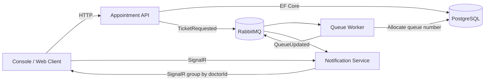
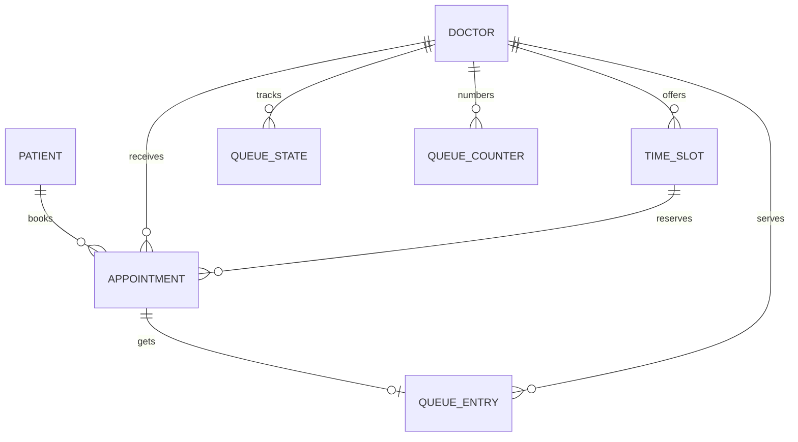

# Clinic Appointment and Queue

Hệ thống đặt lịch khám và quản lý hàng đợi dùng .NET 10 Minimal API, EF Core/PostgreSQL, RabbitMQ và SignalR. Phần 2 triển khai tầng dữ liệu, seed data, endpoint đặt/hủy/tra cứu và transactional outbox cho yêu cầu cấp số. Queue Worker vẫn là skeleton; phần đó sẽ consume `ticket.requested` và cấp `QueueNumber`.

## Kiến trúc



`Clinic.Domain` sở hữu entity và trạng thái; `Clinic.Contracts` định nghĩa message dùng chung; `Clinic.Infrastructure` chứa DbContext, PostgreSQL retry strategy, RabbitMQ publisher và outbox dispatcher. API ghi lịch hẹn cùng `ticket.requested` vào PostgreSQL trong một transaction. Dispatcher publish message persistent với publisher confirm; nếu broker gián đoạn, outbox giữ message và retry theo exponential backoff. Delivery là at-least-once, vì vậy consumer cấp số cần idempotent theo `AppointmentId`.

## Cây thư mục

```text
ClinicQueue.slnx
src/
  Clinic.Contracts/          # TicketRequested, QueueUpdated
  Clinic.Domain/              # Patient, Doctor, TimeSlot, Appointment, Queue*
  Clinic.Infrastructure/      # EF Core DbContext, provider registration
  Clinic.AppointmentApi/      # ASP.NET Core Minimal API host
  Clinic.QueueWorker/         # Worker Service host
  Clinic.NotificationService/ # SignalR hub host
  Clinic.ConsoleClient/       # Console health-check client sample
```

## Mô hình dữ liệu



`QueueState` và `QueueCounter` có khóa ghép `(DoctorId, ServiceDate)`. Unique index trên `(DoctorId, ServiceDate, QueueNumber)` và `(DoctorId, ServiceDate, Number)` là lớp bảo vệ cuối cho số thứ tự; unique index slot `(DoctorId, StartTime)` tránh tạo trùng khung giờ. `TimeSlot` có check constraint `0 <= BookedCount <= Capacity`. Khi triển khai booking, tăng `BookedCount` cần dùng conditional atomic update trong transaction để chặn overbooking.

## Appointment API

| Method | Path | Mục đích |
| --- | --- | --- |
| `GET` | `/doctors` | Danh sách bác sĩ đang hoạt động |
| `GET` | `/doctors/{id}/slots` | Khung giờ tương lai còn chỗ |
| `POST` | `/appointments` | Đặt lịch, trả `201` và tạo ticket request bất đồng bộ |
| `DELETE` | `/appointments/{id}` | Hủy lịch, giải phóng slot, phát queue update |
| `GET` | `/appointments/{id}` | Chi tiết lịch hẹn và trạng thái |
| `GET` | `/queues/{doctorId}?serviceDate=YYYY-MM-DD` | Trạng thái và danh sách hàng đợi trong ngày |
| `POST` | `/queues/{doctorId}/next?serviceDate=YYYY-MM-DD` | Hoàn tất lượt hiện tại, chuyển lượt kế tiếp |

OpenAPI document: `/openapi/v1.json`. DTO đầu vào dùng Minimal API validation; lỗi trả Problem Details với `400`, `404`, `409` hoặc `503`; DB tạm thời không khả dụng kèm header `Retry-After`.

Trong mã hiện tại, booking cập nhật capacity bằng atomic conditional update trong transaction và ghi `Appointment` cùng outbox event trước khi trả `201`. Hủy lịch cập nhật trạng thái, giải phóng slot và ghi queue update nguyên tử; lỗi broker chỉ làm chậm dispatch, không rollback lịch hẹn đã lưu.

Database được tạo lần đầu bằng `EnsureCreatedAsync` và seed idempotent 2 bác sĩ, 3 khung giờ, 2 bệnh nhân/lịch hẹn, queue entries, state và counter. Fixture ID có thể xem trong `src/Clinic.AppointmentApi/DatabaseSeeder.cs`; slot seed là ngày kế tiếp theo UTC.

`src/Clinic.AppointmentApi/AppointmentApi.http` có request mẫu cho từng route. Đổi ngày ở request `/queues/.../next` thành ngày slot được trả về nếu chạy sau ngày fixture hiện tại.

## Chạy bằng Docker Compose

Cần Docker Desktop/Docker Compose v2. Tại thư mục solution:

```powershell
Copy-Item .env.example .env
# Sửa POSTGRES_PASSWORD và RABBITMQ_PASSWORD trong .env
docker compose up --build -d
docker compose ps
```

API: `http://localhost:8080/health/live`; readiness: `http://localhost:8080/health/ready`; Notification Service: `http://localhost:8081/health/live`; SignalR hub: `http://localhost:8081/hubs/queue`. RabbitMQ management UI: `http://localhost:15672`.

Chạy client mẫu một lần: `docker compose --profile demo-client run --rm console-client`. Theo dõi log: `docker compose logs -f appointment-api queue-worker notification-service`. Dừng services: `docker compose down`; xoá database/broker data chỉ khi cần reset hoàn toàn: `docker compose down -v`.

## Cấu hình và logging

Compose inject cấu hình bằng biến môi trường theo quy tắc ASP.NET Core: `ConnectionStrings__Clinic`, `RabbitMq__HostName`, `RabbitMq__UserName`, `RabbitMq__Password`, `Logging__LogLevel__Default`. Trong container, dùng service name `postgres` và `rabbitmq`, không dùng `localhost`. `.env` chỉ dành cho local development; môi trường thật nên lấy secrets từ secret store/orchestrator.

Các host phát console JSON logs, phù hợp để Docker thu thập và lọc. Giữ log mức `Information` cho luồng nghiệp vụ, `Warning` cho retry/dependency chậm và thêm correlation/appointment ID khi triển khai consumer để lần theo một request xuyên API → broker → Worker → notification. Không ghi số điện thoại hoặc dữ liệu định danh bệnh nhân vào log.

## Build local

```powershell
dotnet build ClinicQueue.slnx
dotnet run --project src/Clinic.AppointmentApi
```

Các project hiện build được; database phải chạy và `ConnectionStrings__Clinic` phải được cấu hình khi khởi chạy API. API thực hiện booking/hủy/tra cứu và dispatch outbox; Queue Worker chưa consume ticket request để cấp số tự động. OpenAPI có tại `/openapi/v1.json`.

Đây là phần hoàn thiện tầng dữ liệu và Appointment API; Queue Worker và Notification Service vẫn cần phần triển khai riêng để hoàn tất end-to-end.
