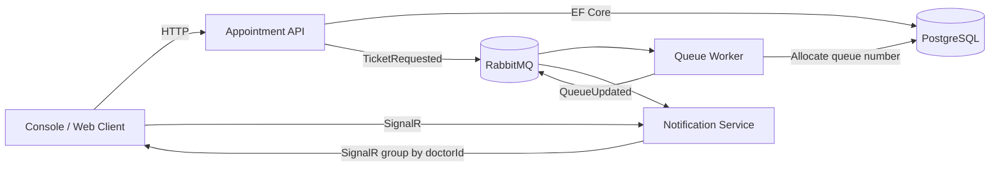
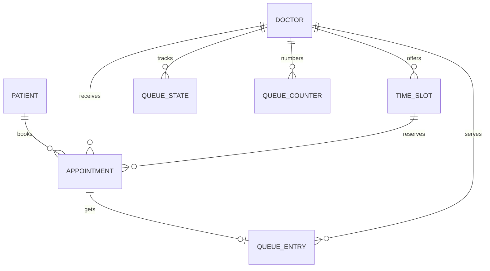
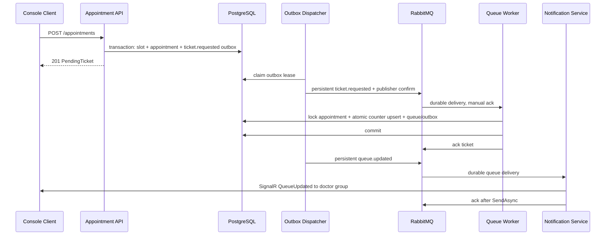

# Clinic Appointment and Queue

Hệ thống đặt lịch khám và quản lý hàng đợi dùng .NET 10 Minimal API, EF Core/PostgreSQL, RabbitMQ và SignalR. Appointment API ghi lịch hẹn cùng transactional outbox; Queue Worker consume `ticket.requested`, cấp số thứ tự và ghi queue update event.

## Kiến trúc



`Clinic.Domain` sở hữu entity và trạng thái; `Clinic.Contracts` định nghĩa message dùng chung; `Clinic.Infrastructure` chứa DbContext, PostgreSQL retry strategy, RabbitMQ publisher và outbox dispatcher. API ghi lịch hẹn cùng `ticket.requested` vào PostgreSQL trong một transaction. Dispatcher publish message persistent với publisher confirm; nếu broker gián đoạn, outbox giữ message và retry theo exponential backoff. Worker consume manual-ack; DB commit xong mới ack. Delivery là at-least-once, Worker khóa appointment khi xử lý và bỏ qua message trùng theo trạng thái/`QueueNumber`.

## Cây thư mục

```text
ClinicQueue.slnx
src/
  Clinic.Contracts/          # TicketRequested, QueueUpdated
  Clinic.Domain/              # Patient, Doctor, TimeSlot, Appointment, Queue*
  Clinic.Infrastructure/      # EF Core DbContext, provider registration
  Clinic.AppointmentApi/      # ASP.NET Core Minimal API host
  Clinic.QueueWorker/         # Worker Service host
  Clinic.NotificationService/ # SignalR hub host
  Clinic.ConsoleClient/       # Console API and SignalR client
```

## Mô hình dữ liệu



`QueueState` và `QueueCounter` có khóa ghép `(DoctorId, ServiceDate)`. Worker dùng PostgreSQL atomic upsert trên `QueueCounter` để lấy số kế tiếp, được bảo vệ thêm bởi unique index `(DoctorId, ServiceDate, QueueNumber)` và `(DoctorId, ServiceDate, Number)`. `TimeSlot` có check constraint cho capacity; booking dùng conditional atomic update trong transaction để chặn overbooking.

Worker khai báo durable queue `clinic.ticket-requests`, retry queues có TTL tăng dần tới 60 giây và dead-letter queue `clinic.ticket-dead-letters`. Lỗi DB được retry qua retry exchange; payload sai hoặc trạng thái không hợp lệ được chuyển vào DLQ để kiểm tra thủ công. Sự kiện `queue.updated` được ghi vào outbox trong cùng transaction cấp số; dispatcher có thể chạy ở API hoặc Worker và dùng lease để tránh cùng claim một message. Notification Service consume durable queue `clinic.queue-updates`, broadcast tên event `QueueUpdated` vào group `doctor:{id}` rồi ack; lỗi gửi được retry và poison message vào `clinic.queue-update-dead-letters`.

## Appointment API

| Method | Path | Mục đích |
| --- | --- | --- |
| `GET` | `/doctors` | Danh sách bác sĩ đang hoạt động |
| `GET` | `/doctors/{id}/slots` | Khung giờ tương lai còn chỗ |
| `POST` | `/appointments` | Đặt lịch, trả `201` và tạo ticket request bất đồng bộ |
| `DELETE` | `/appointments/{id}` | Hủy lịch, giải phóng slot, phát queue update |
| `GET` | `/appointments/{id}` | Chi tiết lịch hẹn và trạng thái |
| `GET` | `/queues/{doctorId}?serviceDate=YYYY-MM-DD` | Trạng thái và danh sách hàng đợi trong ngày |
| `POST` | `/queues/{doctorId}/next?serviceDate=YYYY-MM-DD` | Hoàn tất lượt hiện tại, chuyển lượt kế tiếp |

OpenAPI document: `/openapi/v1.json`. DTO đầu vào dùng Minimal API validation; lỗi trả Problem Details với `400`, `404`, `409` hoặc `503`; DB tạm thời không khả dụng kèm header `Retry-After`.

Trong mã hiện tại, booking cập nhật capacity bằng atomic conditional update trong transaction và ghi `Appointment` cùng outbox event trước khi trả `201`. Hủy lịch cập nhật trạng thái, giải phóng slot và ghi queue update nguyên tử; lỗi broker chỉ làm chậm dispatch, không rollback lịch hẹn đã lưu.

Database được tạo lần đầu bằng `EnsureCreatedAsync` và seed idempotent 2 bác sĩ, 3 khung giờ, 2 bệnh nhân/lịch hẹn, queue entries, state và counter. Fixture ID có thể xem trong `src/Clinic.AppointmentApi/DatabaseSeeder.cs`; slot seed là ngày kế tiếp theo UTC.

`src/Clinic.AppointmentApi/AppointmentApi.http` có request mẫu cho từng route. Đổi ngày ở request `/queues/.../next` thành ngày slot được trả về nếu chạy sau ngày fixture hiện tại.

## Chạy bằng Docker Compose

Cần Docker Desktop/Docker Compose v2. Tại thư mục solution:

```powershell
Copy-Item .env.example .env
# Sửa POSTGRES_PASSWORD và RABBITMQ_PASSWORD trong .env
docker compose up --build -d
docker compose ps
```

API: `http://localhost:8080/health/live`; readiness: `http://localhost:8080/health/ready`; Notification Service: `http://localhost:8081/health/live`; SignalR hub: `http://localhost:8081/hubs/queue`. RabbitMQ management UI: `http://localhost:15672`.

Chạy client tương tác: `docker compose --profile demo-client run --rm console-client`. Menu hỗ trợ xem bác sĩ/slot, đặt/hủy/tra cứu lịch, xem/chuyển lượt và theo dõi SignalR; ở chế độ theo dõi, nhấn Enter để ngắt kết nối. Theo dõi luồng bằng `docker compose logs -f appointment-api queue-worker notification-service`. Dừng services: `docker compose down`; xoá database/broker data chỉ khi cần reset hoàn toàn: `docker compose down -v`.

## Cấu hình và logging

Compose inject cấu hình bằng biến môi trường theo quy tắc ASP.NET Core: `ConnectionStrings__Clinic`, `RabbitMq__HostName`, `RabbitMq__UserName`, `RabbitMq__Password`, `Client__ApiBaseUrl`, `Client__NotificationHubUrl`, `Logging__LogLevel__Default`. Trong container, dùng service name `postgres`, `rabbitmq`, `appointment-api` và `notification-service`, không dùng `localhost`. `.env` chỉ dành cho local development; môi trường thật nên lấy secrets từ secret store/orchestrator.

Các host phát console JSON logs, phù hợp để Docker thu thập và lọc. Worker ghi `AppointmentId`, `DoctorId`, số thứ tự, kết quả xử lý, retry delay và lỗi kết nối; Notification Service log event đã nhận, group được broadcast và ack. Client in log timestamped cho kết nối/nhận cập nhật. Kiểm tra poison messages trong `clinic.ticket-dead-letters` và `clinic.queue-update-dead-letters` từ RabbitMQ management UI. Không ghi số điện thoại hoặc dữ liệu định danh bệnh nhân vào log.

## Build local

```powershell
dotnet build ClinicQueue.slnx
dotnet run --project src/Clinic.AppointmentApi
```

Các project hiện build được; database và RabbitMQ phải sẵn sàng, hoặc cần cấu hình connection string khi chạy API/Worker riêng. API thực hiện booking/hủy/tra cứu; Worker tiêu thụ ticket request và cấp số tự động. OpenAPI có tại `/openapi/v1.json`.

Luồng realtime end-to-end: API/Worker commit outbox → dispatcher publish `queue.updated` → Notification Service consume và gửi SignalR `QueueUpdated` → Console Client nhận theo doctor group và lọc ngày khám.

## Cài đặt, build và chạy

### Yêu cầu

- Docker Desktop với Docker Compose v2.
- .NET 10 SDK nếu build/chạy ứng dụng ngoài container.
- PowerShell 7 hoặc Windows PowerShell để dùng các lệnh kiểm thử bên dưới.

### Chạy toàn hệ thống

```powershell
Copy-Item .env.example .env
# Đổi POSTGRES_PASSWORD và RABBITMQ_PASSWORD trong .env trước khi chạy.
docker compose up --build -d
docker compose ps
```

Compose chờ health check của PostgreSQL và RabbitMQ trước khi khởi chạy API/Worker/Notification Service. API tạo schema demo bằng `EnsureCreatedAsync` và seed dữ liệu nếu database chưa có bác sĩ. Kiểm tra readiness:

```powershell
Invoke-RestMethod http://localhost:8080/health/ready
Invoke-RestMethod http://localhost:8081/health/live
```

Địa chỉ chính: Appointment API `http://localhost:8080`, OpenAPI `http://localhost:8080/openapi/v1.json`, SignalR Hub `http://localhost:8081/hubs/queue`, RabbitMQ Management `http://localhost:15672`.

### Build và chạy local

```powershell
dotnet restore .\ClinicQueue.slnx
dotnet build .\ClinicQueue.slnx -c Release
```

Nếu chạy API/Worker/Notification Service trực tiếp bằng `dotnet run`, trước hết chạy dependency `docker compose up -d postgres rabbitmq`, sau đó cấu hình `ConnectionStrings__Clinic`, `RabbitMq__HostName`, `RabbitMq__UserName`, `RabbitMq__Password`. Trong Docker network, host là `postgres`/`rabbitmq`; chạy ngoài container thì host thường là `localhost`.

Chạy Console Client ngoài container:

```powershell
$env:Client__ApiBaseUrl = "http://localhost:8080"
$env:Client__NotificationHubUrl = "http://localhost:8081/hubs/queue"
dotnet run --project .\src\Clinic.ConsoleClient
```

Hoặc dùng client interactive trong Compose:

```powershell
docker compose --profile demo-client run --rm console-client
```

Menu client có chức năng xem bác sĩ/slot, đặt lịch, đọc/hủy lịch, xem hàng đợi, theo dõi SignalR và chuyển lượt tiếp theo. Chọn `7` để theo dõi; mở một client khác và chọn `8` để tạo thay đổi hàng đợi. Client tự reconnect và đăng ký lại doctor group; sau khi reconnect nên gọi mục `6` để lấy snapshot mới nhất vì SignalR không lưu lịch sử event cho client offline.

## Kiểm thử chức năng

`src/Clinic.AppointmentApi/AppointmentApi.http` chứa request mẫu cho mọi endpoint. Có thể chạy lần lượt bằng REST Client trong VS Code. Luồng PowerShell dưới đây lấy ID động từ seed thay vì dựa vào ID cố định:

```powershell
$base = "http://localhost:8080"
$doctor = Invoke-RestMethod "$base/doctors" | Select-Object -First 1
$slots = Invoke-RestMethod "$base/doctors/$($doctor.id)/slots"
$slot = $slots | Where-Object { $_.availableCount -gt 0 } | Select-Object -First 1
if (-not $slot) { throw "No available seeded slot was returned." }

$request = @{
  patientName = "Test Patient"
  patientPhone = "+84908887766"
  doctorId = [string]$doctor.id
  timeSlotId = [string]$slot.id
} | ConvertTo-Json

$appointment = Invoke-RestMethod -Uri "$base/appointments" -Method Post `
  -ContentType "application/json" -Body $request
$appointment | Format-List
```

POST trả `201 Created` với `status=PendingTicket`; đây là xác nhận booking, chưa phải xác nhận đã cấp số. Worker xử lý bất đồng bộ; đọc lại trạng thái đến khi `Confirmed` và `queueNumber` có giá trị:

```powershell
$appointment = Invoke-RestMethod "$base/appointments/$($appointment.id)"
$date = [string]$appointment.serviceDate
Invoke-RestMethod "$base/queues/$($doctor.id)?serviceDate=$date" | Format-List
```

Để kiểm tra từng nghiệp vụ, thực hiện theo thứ tự:

| Bước | Thao tác | Kết quả mong đợi |
| --- | --- | --- |
| 1 | `GET /doctors` | `200`, trả bác sĩ đang hoạt động |
| 2 | `GET /doctors/{id}/slots` | `200`, slot tương lai có `availableCount > 0` |
| 3 | `POST /appointments` | `201`, trạng thái ban đầu `PendingTicket` |
| 4 | Lặp `GET /appointments/{id}` | Chuyển sang `Confirmed`, có `queueNumber` sau khi Worker xử lý |
| 5 | `GET /queues/{doctorId}?serviceDate=...` | Thấy lượt đang phục vụ, số cuối và ticket mới |
| 6 | Mở client menu `7`, rồi ở client khác chọn `8` | SignalR in event `QueueUpdated` cho đúng bác sĩ/ngày |
| 7 | Hủy một appointment chưa `InProgress` | `204`, slot được giải phóng và queue update được phát |
| 8 | Hủy appointment không tồn tại/đang khám | Lần lượt `404`/`409` dạng Problem Details |

Các trường hợp bổ sung: body sai nhận `400`; slot đầy/hết hạn nhận `409`; DB mất kết nối khi gọi API nhận `503` và `Retry-After`. Thử song song nhiều booking vào một slot còn ít chỗ bằng Postman Runner hoặc công cụ tải; số response `201` không được vượt capacity còn lại, và các queue number đã cấp phải duy nhất theo bác sĩ/ngày.

## Kiểm thử gián đoạn và phục hồi

Các thao tác sau dùng `docker compose stop/start`, không xóa volume. Chỉ chạy sau khi stack đã khởi tạo và các durable queue đã được khai báo ít nhất một lần.

### RabbitMQ dừng khi tạo booking

1. Chạy `docker compose stop rabbitmq`.
2. Tạo appointment qua Console/API. API vẫn có thể trả `201` vì transaction đã lưu appointment và outbox trong PostgreSQL; không phụ thuộc việc broker đang online.
3. Xem `docker compose logs -f appointment-api queue-worker`; dispatcher ghi log retry, outbox event vẫn chưa đánh dấu published.
4. Chạy `docker compose start rabbitmq`. RabbitMQ health check trở lại healthy, dispatcher publish event; Worker nhận và cấp số. Xác nhận bằng `GET /appointments/{id}`.

### Queue Worker tạm dừng

1. Chạy `docker compose stop queue-worker`.
2. Tạo appointment. Outbox dispatcher có thể publish vào durable queue `clinic.ticket-requests`; nếu chưa publish được thì outbox giữ event.
3. Chạy `docker compose start queue-worker` và theo dõi `docker compose logs -f queue-worker`.
4. Worker xử lý message còn tồn, commit queue number/outbox rồi mới ack. Kiểm tra appointment chuyển sang `Confirmed`.

### PostgreSQL tạm dừng khi Worker xử lý ticket

1. Dừng Worker, tạo một booking để ticket nằm chờ trong RabbitMQ, rồi chạy `docker compose stop postgres`.
2. Chạy `docker compose start queue-worker`. Worker nhận ticket nhưng DB retry hết lượt; message được publish sang retry queue có TTL rồi ack bản gốc sau publisher confirm. Các lần retry tăng delay đến tối đa 60 giây.
3. Chạy `docker compose start postgres`; chờ health check healthy.
4. Retry queue dead-letter message trở lại `clinic.ticket-requests`; Worker cấp số. Kiểm tra logs và `GET /appointments/{id}`.
5. Gọi API trong lúc DB dừng để xác nhận readiness/error path trả `503`; booking không được ghi một phần vì cập nhật slot, appointment và outbox nằm trong cùng transaction.

### Notification Service dừng

1. Đảm bảo Notification Service đã chạy ít nhất một lần để khai báo durable queue `clinic.queue-updates`, sau đó `docker compose stop notification-service`.
2. Tạo queue event bằng một booking mới hoặc `POST /queues/{doctorId}/next`.
3. `docker compose start notification-service`; consumer đọc backlog và broadcast event sau khi kết nối lại.
4. SignalR không phải event store: nếu client chưa kịp reconnect trước khi event broadcast, gọi `GET /queues/{doctorId}?serviceDate=...` để đồng bộ snapshot.

### Broker dừng khi consumer đang chạy

Worker và Notification Service bật RabbitMQ automatic recovery, đồng thời có vòng lặp reconnect khi phải tạo lại connection. Khi connection đóng, unacked message được RabbitMQ đưa lại queue; sau khi broker phục hồi, consumer kết nối lại và xử lý. Nếu publish bản retry thất bại, consumer không ack bản gốc và requeue khi channel còn hoạt động.

Không dùng `docker compose down -v` trong các bài thử phục hồi: tùy chọn `-v` xóa dữ liệu PostgreSQL/RabbitMQ, khác với sự cố service tạm thời.

## Cơ chế giao tiếp phân tán



HTTP dùng cho thao tác cần phản hồi ngay và PostgreSQL là nguồn dữ liệu chuẩn. Cấp số/phát notification là bất đồng bộ. Transactional outbox tránh dual-write giữa DB và RabbitMQ; publisher confirm cùng message persistent/durable queue hỗ trợ phục hồi broker. Mô hình là at-least-once, không phải exactly-once: Worker dùng row lock theo appointment, trạng thái/`QueueNumber` để bỏ qua redelivery; khóa ghép, atomic upsert và unique indexes ngăn cấp trùng.

SignalR group hiện ở bộ nhớ của một Notification Service instance. Nếu scale service này thành nhiều replica, cần SignalR Redis backplane hoặc fan-out queue riêng cho từng replica; queue consumer cạnh tranh dùng chung hiện tại chỉ giao mỗi event cho một replica.

## Yêu cầu mở rộng và trạng thái

| Yêu cầu | Hiện trạng | Hướng mở rộng/kiểm chứng |
| --- | --- | --- |
| Retry và DLQ | Đã có TTL retry queues, delay tăng dần tới 60 giây và DLQ riêng cho ticket/notification poison message | Theo dõi độ sâu queue/DLQ, quy trình kiểm tra và replay có kiểm soát; đặt cảnh báo cho retry kéo dài |
| Idempotent consumer | Worker khóa row appointment, kiểm tra trạng thái/`QueueNumber`; DB có unique constraints | Bổ sung API idempotency key để client retry POST sau timeout không tạo appointment mới |
| Correlation ID | Chưa truyền xuyên HTTP/RabbitMQ | Nhận/tạo `X-Correlation-ID` hoặc W3C `traceparent`, lưu trong outbox, gán `BasicProperties.CorrelationId`, log cùng scope |
| Health check | API có live/ready DB; Compose kiểm tra PostgreSQL/RabbitMQ; Notification có liveness | Bổ sung readiness cho Notification/Worker, kiểm tra trạng thái broker và consumer heartbeat; health endpoint không nên publish message kiểm tra |
| Structured logging | Các host dùng JSON console và log IDs/trạng thái/retry | Bổ sung correlation/trace ID, metrics về outbox age, queue depth, retries, DLQ; tuyệt đối tránh ghi phone/name bệnh nhân |

Trong môi trường demo Compose chỉ có một RabbitMQ và một Notification Service; durable queue/volume không đồng nghĩa broker HA. Production cần topology RabbitMQ replicated/quorum được sizing phù hợp, migrations thay cho `EnsureCreatedAsync`, secrets manager, TLS/auth cho API/Hub và quan sát metrics/alerts.

## Dàn ý báo cáo bài tập lớn

Nên gắn từng nhận định với ảnh chụp, log, request/response hoặc kết quả thử nghiệm; tránh chỉ đưa sơ đồ mà không có bằng chứng chạy.

1. **Trang đầu và tóm tắt**: đề tài, lớp/nhóm, thành viên và phân công; vấn đề, mục tiêu, phạm vi, kết quả chính.
2. **Khảo sát và yêu cầu**: quy trình đặt khám/hàng đợi; actor; use case; yêu cầu chức năng; yêu cầu phi chức năng (tính nhất quán, độ trễ, phục hồi, bảo mật); tiêu chí nghiệm thu.
3. **Kiến trúc phân tán**: sơ đồ context/container/component; trách nhiệm API, Worker, Notification, Client, PostgreSQL, RabbitMQ; lý do chọn HTTP cho query/command và message cho xử lý bất đồng bộ.
4. **Thiết kế dữ liệu**: ERD; trạng thái appointment; khóa/index/check constraint; capacity update; queue counter/state; transactional outbox; giải thích race condition và cách chống cấp trùng.
5. **Thiết kế giao tiếp và luồng nghiệp vụ**: sequence diagram booking, cấp số, hủy, chuyển lượt, broadcast SignalR; contract `TicketRequested`/`QueueUpdated`; routing key, durable queue, ack/retry/DLQ.
6. **Hiện thực**: cấu trúc solution; API/DTO/status code; Queue Worker; Notification Hub/group; Console Client; Dockerfile/Compose; cấu hình và seed data.
7. **Đảm bảo tin cậy và vận hành**: at-least-once/idempotency; outbox lease; retry/backoff/DLQ; mất DB/broker/client; health checks; structured logs; giới hạn hiện tại (single Rabbit/SignalR instance, correlation ID chưa có).
8. **Kiểm thử và kết quả**: môi trường/phiên bản; test matrix API; concurrency booking/cấp số; fault injection từng service; thời gian phục hồi; log/screenshot; lỗi phát hiện và cách xử lý.
9. **Triển khai và hướng dẫn sử dụng**: cấu hình `.env`; build/run; endpoint; thao tác Console; xem log/Rabbit management; reset dữ liệu có cảnh báo.
10. **Đánh giá theo rubric và kết luận**: bảng tiêu chí–bằng chứng–kết quả; mức đạt/chưa đạt; hạn chế; hướng phát triển (auth, migrations, correlation, metrics, HA/backplane).
11. **Tài liệu tham khảo và phụ lục**: tài liệu .NET/EF Core/RabbitMQ/SignalR; API `.http`; cấu hình Compose; test data; log; phân công thành viên.

### Bảng đối chiếu minh chứng

| Tiêu chí đánh giá | Minh chứng nên đưa vào báo cáo |
| --- | --- |
| Kiến trúc service phân tán | Sơ đồ service, ranh giới trách nhiệm, sequence HTTP/RabbitMQ/SignalR |
| Mô hình dữ liệu và toàn vẹn | ERD, index/constraint, transaction booking, test capacity đồng thời |
| Message broker và xử lý lỗi | Queue/exchange/DLQ, persistent delivery, retry logs, broker stop/start |
| Real-time | Client tham gia `doctor:{id}`, log `QueueUpdated`, snapshot REST khi reconnect |
| Chức năng API/client | Bảng endpoint/status, ảnh Console, request `.http` và response thực tế |
| Container và cấu hình | `docker compose ps`, health checks, service DNS, cấu hình secrets mẫu |
| Chất lượng kiểm thử | Test matrix, kết quả build, concurrency/fault-injection, hạn chế còn lại |
